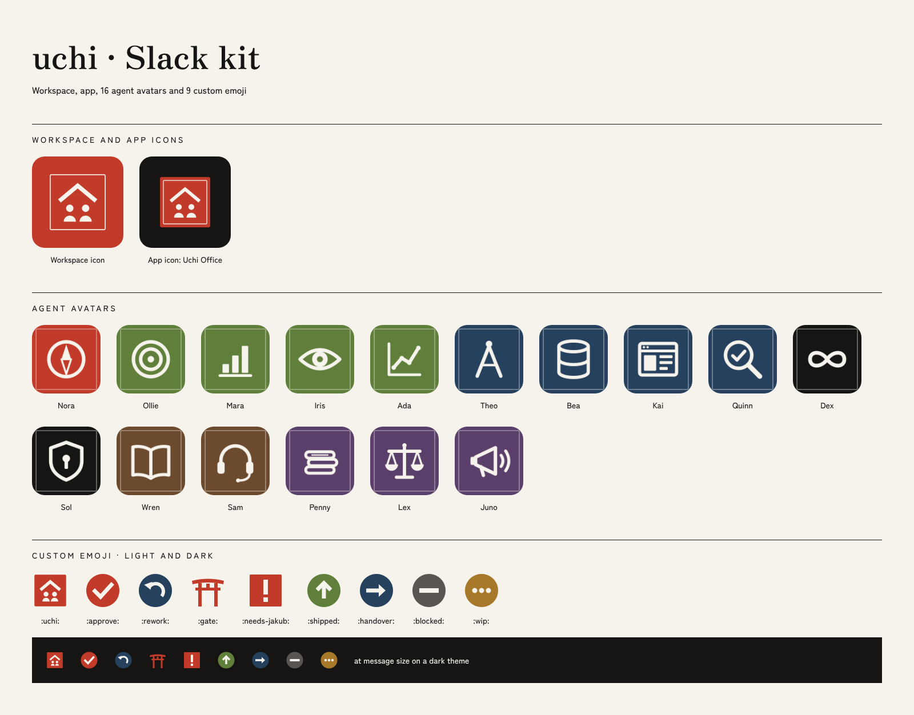

# uchi brand

Logo, Slack icons and agent avatars for **uchi** (家, "home"). Public on purpose: Slack loads each agent's avatar from here. Nothing private lives in this repo.

| Folder | What |
| --- | --- |
| `workspace/` | Slack workspace icon (1024 px) |
| `app/` | Uchi Office app icon (1024 px) |
| `avatars/` | One avatar per agent, 512 px, used as the Slack `icon_url` |
| `emoji/` | Custom Slack emoji, 128 px, transparent |
| `source/render.js` | How every image is drawn (Playwright + the Zen fonts); change it and re-render instead of editing PNGs |

**Colours:** Shu `#C23B2A` · Sumi `#161514` · Washi `#F6F3EC`. Departments: Matcha `#5F7F3A` product, Ai `#26415E` engineering, Sumi ops and security, Kogecha `#6B4A2E` docs and support, Murasaki `#5B3F6B` business.

**Type:** Zen Old Mincho (wordmark, display), Zen Kaku Gothic New (text).
